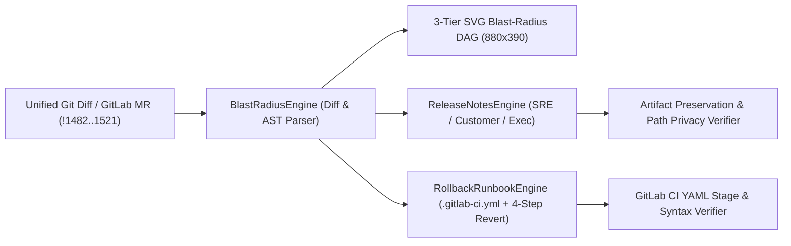

# System Architecture — ShipStory CI

## 1. End-to-End Data Flow

---

## 2. Core Modules

| Module | File Path | Key Responsibility & Deterministic Guarantee |
| :--- | :--- | :--- |
| **BlastRadiusEngine** | `src/lib/diff/blast-radius-engine.ts` | Parses unified git diffs, extracts env vars & SQL DDL, computes `0–100` risk score, lays out 3-tier SVG DAG (`verifyZeroNodeOverlap`), and isolates connected subgraphs (`isolateBlastSubgraph`). |
| **ReleaseNotesEngine** | `src/lib/changelog/release-notes-engine.ts` | Synthesizes SRE, Customer, and Executive release briefs across 4 production MRs or custom diffs; enforces 100% critical token retention in SRE notes and 0 internal file path leaks in Customer notes (`verifyArtifactPreservation`). |
| **RollbackRunbookEngine** | `src/lib/rollback/rollback-runbook-engine.ts` | Produces 4-step incident revert runbooks and copy-ready `.gitlab-ci.yml` canary + auto-rollback pipelines (`verifyGitLabCiYamlSyntax`). |
| **GitLabAIAdapter** | `src/lib/ai/gitlab-ai-adapter.ts` | Provides 0ms local deterministic inference by default plus optional live LLM synthesis guarded by a `4.5s` `AbortController` circuit breaker (`runShipStoryPipeline`). |
